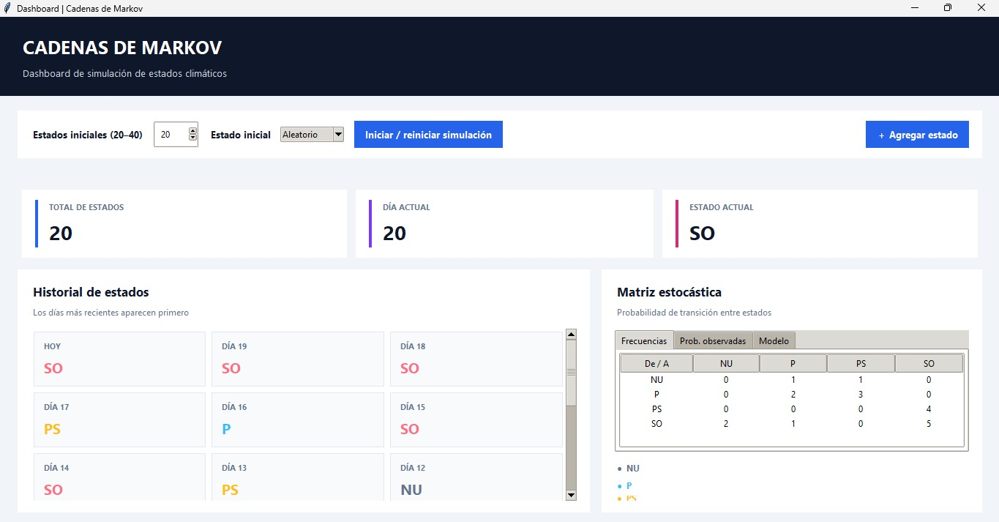

# Cadenas de Markov: Simulación de estados climáticos

Proyecto académico desarrollado para el curso de **Matemática Discreta** de la Universidad Peruana de Ciencias Aplicadas (UPC), sección 3638, durante el ciclo 2025-01.

El proyecto fue realizado de manera grupal. Por motivos de privacidad, esta versión pública del informe muestra únicamente mi nombre.



## Descripción del proyecto

Este proyecto implementa una simulación basada en **cadenas de Markov** para representar la evolución de diferentes condiciones climáticas durante un periodo de 20 a 40 días.

Se consideran cuatro estados climáticos:

- **NU:** Nublado.
- **P:** Parcialmente nublado.
- **PS:** Parcialmente soleado.
- **SO:** Soleado.

Mediante una secuencia de estados, el programa registra las transiciones entre las distintas condiciones climáticas y construye matrices que permiten analizar sus frecuencias y probabilidades. De esta manera, se puede observar cómo evoluciona el comportamiento del sistema a partir de las probabilidades de transición establecidas.

## Funcionalidades

- **Generación de secuencias:** permite simular entre 20 y 40 días, seleccionando aleatoriamente el estado inicial o estableciéndolo manualmente.
- **Simulación de transiciones:** incorpora nuevos estados a la secuencia mediante las probabilidades correspondientes al estado actual, aplicando la propiedad de Markov.
- **Historial de estados:** muestra los estados climáticos registrados, ordenados desde el día más reciente.
- **Análisis de matrices:** presenta tres matrices para estudiar el comportamiento del modelo:
  - **Frecuencias:** registra la cantidad de veces que ocurre cada transición entre estados.
  - **Probabilidades observadas:** muestra las frecuencias de transición normalizadas por fila.
  - **Modelo:** representa las probabilidades teóricas de transición utilizadas para generar la simulación.

## Matriz de transición del modelo

La simulación utiliza la siguiente matriz de transición, donde cada fila representa el estado actual y cada columna indica el posible estado siguiente.

| De / A | NU | P | PS | SO |
|:---:|:---:|:---:|:---:|:---:|
| **NU** | 0.00 | 0.67 | 0.33 | 0.00 |
| **P** | 0.00 | 0.40 | 0.60 | 0.00 |
| **PS** | 0.00 | 0.00 | 0.10 | 0.90 |
| **SO** | 0.40 | 0.20 | 0.00 | 0.40 |

Cada fila suma 1, ya que representa el conjunto de probabilidades de transición desde un estado determinado.

A medida que se generan más transiciones, las probabilidades observadas pueden aproximarse a las probabilidades teóricas del modelo, permitiendo comparar el comportamiento de la simulación con el planteado inicialmente.

## Contenido del repositorio

| Archivo | Descripción |
|---|---|
| `Cadenas_Markov.py` | Aplicación desarrollada en Python con interfaz gráfica mediante Tkinter. |
| `INFORME-MATE-DISCRETA.pdf` | Informe académico que contiene el desarrollo del proyecto correspondiente a la semana 3. |
| `Evidencia_Dashboard-CadenaDeMarkov.png` | Captura de pantalla de la aplicación en funcionamiento. |

## Tecnologías utilizadas

- **Python 3:** lenguaje de programación empleado para desarrollar la lógica de simulación.
- **Tkinter:** biblioteca utilizada para construir la interfaz gráfica de usuario.

## Requisitos

- Python 3 instalado.
- Tkinter, generalmente incluido en la instalación estándar de Python.

## Cómo ejecutar el proyecto

1. Clonar o descargar este repositorio.
2. Abrir una terminal en la carpeta del proyecto.
3. Ejecutar el siguiente comando:

```bash
python Cadenas_Markov.py
```

Al iniciar la aplicación, se mostrará el dashboard desde el cual será posible generar la secuencia climática, agregar nuevos estados y consultar las matrices de transición.

## Propósito académico

El objetivo del proyecto es aplicar los conceptos de **cadenas de Markov, probabilidades de transición y matrices estocásticas** mediante una simulación práctica. Asimismo, permite comprender cómo un sistema probabilístico puede representar la evolución de distintos estados y cómo sus transiciones pueden analizarse a partir de datos observados.
